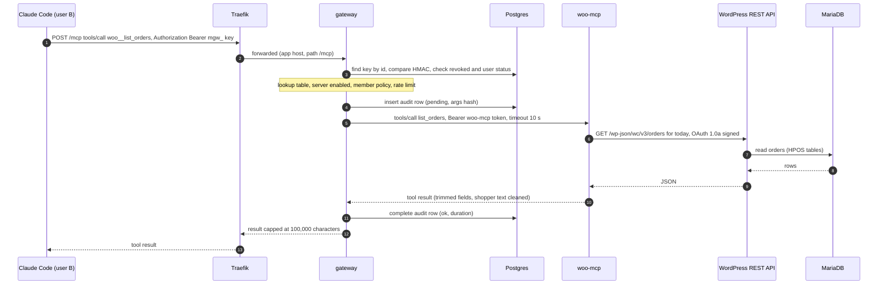
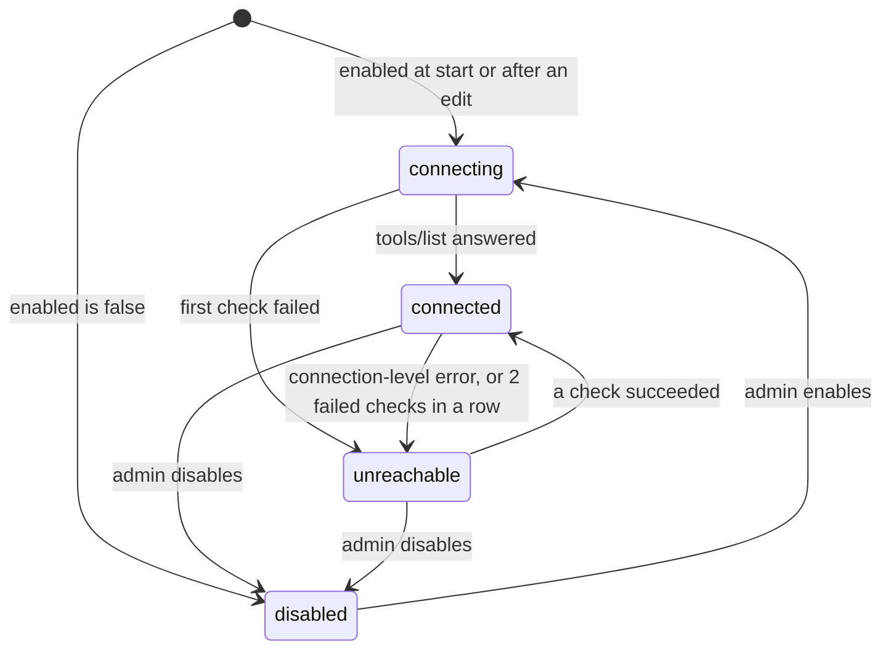

# System design and tradeoffs

This note explains how the system is built and why, how the gateway aggregates and routes tools, what happens
when an upstream is slow or dead, what changes between the laptop and production, and where the design stops
scaling. Every number here comes from the code; file paths point to it. The threat model is in
[THREAT-MODEL.md](THREAT-MODEL.md), day-2 operations in [OPERATIONS.md](OPERATIONS.md).

## Components

| Component | Namespace | Kind | Responsibility |
|---|---|---|---|
| WordPress + WooCommerce (`images/wordpress`) | `store` | Deployment ×1, `Recreate` | The storefront and wp-admin. Public through Ingress `store.<domain>`. An init container (`urumi-bootstrap.sh`) configures the store idempotently on every start. |
| MariaDB 11.8.9 | `store` | StatefulSet ×1 | The store's database, on a PVC. |
| wp-cron | `store` | CronJob, every 5 min | Runs due WP-Cron events with WP-CLI (WordPress's HTTP loopback cron cannot work in-cluster). |
| **woo-mcp** (`apps/woo-mcp`) | `store` | Deployment ×1 | Our WooCommerce MCP server: `list_products`, `get_product`, `create_product`, `list_orders`, `get_order`, `update_order_status`. ClusterIP only. |
| **supplier-mcp** (`apps/supplier-mcp`) | `mcp-upstreams` | Deployment ×1 (chart `charts/mcp-server`) | A second in-cluster MCP server (a supplier catalog). Its `list_products` collides with woo's on purpose; it is the pod-kill target. |
| **gateway** (`apps/gateway`) | `platform` | Deployment ×1 | MCP client to every upstream and one MCP server for everyone; the dashboard's REST API; the chat agent; health loop; policies, rate limits, audit; metrics on `:9091`. |
| **dashboard** (`apps/dashboard`) | `platform` | Deployment ×1 | Static React SPA on nginx-unprivileged; talks only to the gateway's `/api` on the same origin. |
| Postgres 18.6 | `platform` | StatefulSet ×1 | The gateway's state: users, sessions, invites, API key hashes, servers (credentials encrypted), policies, audit log. |
| Firecrawl, AgentMail | outside | hosted MCP servers | Third-party upstreams with credentials that only the gateway holds (`Authorization: Bearer` and a custom `x-api-key` header). |

Three charts install this: `charts/woo-store`, `charts/mcp-server` (with `instances/supplier.yaml`) and
`charts/platform`. Namespaces are created by `cluster/namespaces.yaml`, not by the charts, so `helm uninstall`
never deletes one and the Pod Security labels (`enforce: baseline`, `warn`/`audit: restricted`) are set once.

## Architecture choices

| Choice | Why | Rejected alternative |
|---|---|---|
| **TypeScript end to end**, MCP TypeScript SDK v2 (2.3.1), pnpm monorepo | The official SDK is the reference implementation of both protocol eras, and one language covers the UI, the gateway and our MCP servers. | Python with FastMCP: its proxy/mount helpers would hide the routing, naming and failure handling this project has to show and control. |
| **Dual-era serving** (`createMcpHandler(..., { legacy: 'stateless' })`) and per-upstream negotiation (`versionNegotiation: { mode: 'auto' }`) | Spec 2026-07-28 is stateless (no `initialize`, no session id, `subscriptions/listen` for notifications, cache hints on list results), but Cursor, Inspector and many hosted servers still speak 2025-11-25. The gateway serves both eras on one endpoint, and its client probes each upstream with `server/discover` and falls back to the old handshake (Firecrawl negotiates the legacy era, AgentMail the modern one). | Modern only (breaks Cursor and legacy upstreams); legacy only (no live tool-list push to Claude Code). |
| **Low-level `Server` with two handlers** (`tools/list`, `tools/call`) on **Hono** | The protocol stays visible in our code; the SDK only does framing, both eras and headers. Hono works on Web `Request`/`Response`, which is what the SDK's handler takes. | The SDK's high-level server and proxy helpers. |
| **Postgres 18.6 in the cluster** with Drizzle | Users, keys, servers, policies and the audit log need transactions (the last-admin guard locks rows), unique constraints and several writers. The brief says everything runs in the cluster. Drizzle is thin typed SQL; migrations are committed SQL files applied at startup under an advisory lock. | SQLite on a PVC (one writer, no path to a second replica); a hosted database (not in the cluster). |
| **k3d locally, k3s on the VPS**, both `v1.36.5+k3s1` | The same Traefik, local-path storage, ServiceLB and kube-router NetworkPolicy controller in both places, so the values files are the only difference. | kind or minikube: different ingress and CNI, so NetworkPolicy behaviour would have to be re-proven on the VPS. |
| **Traefik** with standard `Ingress` objects, default timeouts | It ships with k3s; ingress-nginx was retired in March 2026. A 200-second MCP notification stream survived Traefik's defaults in a spike (the SDK sends a keepalive every 15 s), so no timeout is raised. | ingress-nginx; Gateway API (not needed for two hosts); unlimited timeouts (invite slow-request DoS). |
| **Our own Helm templates** | Bitnami's WordPress and MariaDB charts and images are effectively gone (2025). Templates we wrote are templates we can explain and harden: non-root, read-only root filesystems, default-deny NetworkPolicies, render-time guards against empty or `latest` image tags. | Bitnami or other community charts. |
| **Immutable WordPress image** | Core, WooCommerce 11.2.1, Storefront 4.6.2 and WP-CLI are baked in and checksum-verified at build time; only `wp-content/uploads` is on a PVC, and PHP never runs from it. No downloads at boot (the store has no egress), reproducible, and an upgrade is a new image tag. | Installing plugins at runtime onto a PVC: drift, needs egress, no clean rollback. |
| **woo-mcp → WooCommerce REST API v3, signed with OAuth 1.0a** (HMAC-SHA256) as a dedicated `mcp-bot` user | REST goes through WooCommerce's business logic (HPOS order tables, stock, hooks) and is versioned. Over in-cluster plain HTTP, WooCommerce accepts API keys only as an OAuth 1.0a signature (Basic auth needs `is_ssl()`), so the consumer secret never crosses the wire. The signature base uses the store's home URL with scheme `http`, exactly as WooCommerce rebuilds it (`apps/woo-mcp/src/woo/oauth1.ts`, test vectors generated with WooCommerce's own PHP). The `urumi_mcp_bot` role has only the 12 capabilities the six tools need: no deletes, settings or customers. | WP-CLI through `kubectl exec` (needs `pods/exec`, which is code execution in the WordPress pod); direct SQL (bypasses WooCommerce); an existing WooCommerce MCP plugin (the brief forbids it). |
| **`existingSecret` pattern**: charts reference Secrets by name; `scripts/secrets.sh` creates them | Internal secrets are generated once and never regenerated under a live volume; external ones come from the gitignored `.env`; the same script runs locally and against the VPS; values are never printed, and server-side apply keeps them out of the `last-applied-configuration` annotation. | Helm `lookup` + `randAlphaNum` (returns nothing under `helm template` and dry runs, and a regenerated DB password locks the app out of its own volume); secrets in values files. |
| **Chat loop in our backend, calling the gateway's own MCP endpoint** | The brief says nothing but the gateway talks to upstreams. The chat agent is an MCP client of a loopback-only listener (`127.0.0.1:8081`) and authenticates with a 5-minute HS256 JWT for the logged-in user, so it gets the same policies, rate limits and audit rows as Claude Code (`via: chat`). The loop is hand-written (`apps/gateway/src/chat/loop.ts`) and bounded at 8 model calls per reply. | The model provider's MCP connector (it needs a public URL, which local k3d does not have, and hands a third party a gateway credential); calling upstreams from the chat code (bypasses audit and policies); an agent framework. |
| **Claude Haiku 5.5** (`claude-haiku-5-5`) | Small, fast and inexpensive with reliable tool use; the brief grades the loop, not the model. `gateway.llmModel` switches it (for example to `claude-sonnet-5-5`). | A larger model by default (cost per turn); a local model (needs far more CPU/GPU than the target node). |
| **API keys `mgw_<id>_<secret>`**, HMAC-SHA256 with a pepper, looked up by id, never cached | A 256-bit random secret needs no slow hash; the pepper (a Secret, not in the DB) means a database dump alone cannot confirm a guessed key; no cache means a revoked key fails on its very next request. | bcrypt/argon2 on every MCP request (CPU for no gain); a cache with a TTL (revocation would lag). |
| **One choke point**, `ToolRouter.callTool` | Both MCP listeners (public and the chat's internal one) end in the same function, so policies, rate limits, audit, timeouts and result caps cannot be bypassed. The audit row is written *before* the upstream is called: if it cannot be written, the call does not happen. | Logging after the call (a crash loses the row). |
| **Same-origin dashboard**, HttpOnly session cookie, `X-Urumi-CSRF: 1` header on every state-changing request | No CORS and no tokens in JavaScript. A cross-site page cannot add a custom header without a CORS preflight, which the gateway never answers. | A JWT in `localStorage` (readable by any XSS). |

## Tool aggregation and naming

The gateway keeps the last tool list of every server (in memory and in Postgres, so a restart starts with
it) and rebuilds an aggregated **catalog** whenever a server or its tools change
(`apps/gateway/src/catalog/catalog.ts`, `naming.ts`):

1. **Allowlist.** A server can have a tool allowlist; everything else is never exposed. The seeds use it to
   expose 3 of Firecrawl's tools and only `send_message` from AgentMail.
2. **Name.** Exposed name = `<slug>__<tool>`. The slug matches `^[a-z][a-z0-9-]{1,11}$` (no underscores, so
   `__` can only be our separator) and is immutable, and never reused even after a delete, because the audit
   log refers to servers by slug. The tool part is reduced to `[A-Za-z0-9_-]`; names over 48 characters become
   the first 41 characters + `_` + 6 hex of `sha256(slug__originalName)`: stable across restarts, and different
   for two long names that share a prefix (a clash is still caught by the next rule). 48 leaves room for
   client prefixes (Claude Code shows `mcp__<server>__<tool>`; model APIs accept 64).
3. **Collisions.** Prefixing every tool, not only clashing ones, means names never change when another server
   is added. Two upstream names that clean to the same string on one server (`a.b` and `a_b`) cannot both be
   exposed; the first in sorted order wins and the other is logged and hidden.
4. **Cleaning.** Description = `[<slug>]`, a space, then the upstream description with invisible characters (controls,
   zero-width, bidi, Unicode tags, variation selectors) removed, capped at 1,500 characters. Every
   `description` and `title` string inside the input schema is cleaned the same way; names, `enum`, `const`,
   `default` and `pattern` are never changed, because the upstream validates against them. A schema over
   32 KB, or one that still holds invisible characters after cleaning, is not exposed.
5. **Annotations.** Only `readOnlyHint`, `destructiveHint`, `idempotentHint`, `openWorldHint` and a cleaned
   `title` are passed. They are trusted only from our own in-cluster servers; every third-party tool is shown as
   the worst case (`readOnlyHint: false, destructiveHint: true, openWorldHint: true`). `outputSchema` and
   `_meta` are dropped (the gateway may truncate results, so it cannot promise a schema).
6. **Fingerprint.** Each tool's definition is hashed (SHA-256 of canonical JSON). A hash that changes after the
   tool was first seen is logged and shown on the dashboard ("rug pull" detection); text that reads like
   prompt injection is flagged `suspicious`. Both are warnings, not blocks (see the threat model).

`tools/list` returns, for the caller, the catalog's tools of **enabled** servers minus the tools a policy
denies their role, sorted by server slug and tool name. The list is computed per request; the 2026-07-28 cache
hints say `ttlMs: 0, cacheScope: private`.

## Routing: how one tool call travels

Routing uses the catalog's lookup table `exposedName → (serverId, originalName)` and never splits names on
`__`. Every call goes through `ToolRouter.callTool` (`apps/gateway/src/mcp/toolRouter.ts`):

1. lookup → unknown name: JSON-RPC error `-32602`;
2. server enabled? → no: `-32602` and an audit row `denied`;
3. member policy → denied: `-32602` and an audit row `denied`;
4. per-user rate limit → over: a tool result with `isError: true` (`<slug>: rate limited: ...`) and an audit row `denied`;
5. audit row `pending` (who, which key, server, tool, SHA-256 of the arguments, never the arguments);
6. upstream call with the server's timeout and the caller's abort signal;
7. result capped, audit row completed with status, duration and a short error text.

B's API key stops at step 3 of the diagram: the MCP handler receives only a principal (user id, role, key
prefix), and the upstream client was built with the gateway's own credential for that server. woo-mcp works
out "today" in the store's timezone and queries WooCommerce with `after`/`before` in UTC
(`dates_are_gmt=true`). The chat agent takes the same path from step 3 on, through the internal listener.

Two kinds of error, on purpose: a **client mistake** (unknown, disabled or denied tool) is a JSON-RPC error;
**upstream trouble** (timeout, unreachable, the upstream's own `isError`, rate limit) is a normal tool result
with `isError: true` and a readable reason such as `supplier: unreachable (connection refused)`. Models handle
the second kind far better: they can tell the user or try something else.

## Failure handling

### Upstream status

`apps/gateway/src/upstreams/manager.ts` supervises one MCP client per enabled server, created lazily and
replaced after errors. Its health check is a real `tools/list` (bypassing the SDK's own cache), which also
refreshes the tool catalog.

| | In-cluster server (host in `INTERNAL_HOST_ALLOWLIST`) | Third-party server |
|---|---|---|
| Check interval while healthy | 5 s (`HEALTH_INTERVAL_MS`) | 30 s (each check costs the third party a request) |
| Check timeout | 3 s | 3 s |
| After the 1st to 3rd failed check | retry after 5 s | retry after 5 s |
| After that | the gap doubles: 10, 20, then 30 s (cap: 6 × the interval) | 10, 20, 40, 80, 160, then 180 s |

A server becomes **Unreachable** immediately on a connection-level failure (connection refused, DNS failure,
connection reset, connect timeout, host or network unreachable, TLS error, an address the SSRF guard blocks) or
an authentication failure (HTTP 401/403), and immediately if it never connected since supervision started.
Anything else (a 3-second timeout, an HTTP 500, a protocol error) needs **two failed checks in a row**, so one
slow answer does not flip the dashboard red. The reason is kept as short, safe text
(`apps/gateway/src/upstreams/errors.ts`) and shown on the dashboard, in `/api/servers`, in the audit row and in
the `isError` text. Measured on the local cluster (`scripts/e2e-dod.mjs` d12): supplier scaled to 0 showed
Unreachable, "connection refused", 4 to 5 s later; after scaling back it was Connected again within about
12 s. On kube-router a connection blocked by a NetworkPolicy is *refused*, not dropped, exactly like a Service
with no ready pods; the reason text is the same, and the operator tells them apart with `kubectl`
([OPERATIONS.md](OPERATIONS.md#why-is-a-server-unreachable)).

### Disabled versus unreachable

| | Disabled (admin decision) | Unreachable (observed failure) |
|---|---|---|
| In `tools/list` | hidden | **still listed** (last known tools) |
| `tools/call` | JSON-RPC error `-32602`, audit `denied` | fails fast without network I/O: `isError` `<slug>: unreachable (<reason>)`, audit `unreachable` |
| Clients notified | `notifications/tools/list_changed` | no (the list did not change) |

Keeping an unreachable server's tools listed means the list does not flap while a pod restarts, and one dead
server never breaks listing for the others. Hiding disabled tools is a decision, so it is pushed to clients.

### Timeouts and in-flight calls

| What | Limit | Where |
|---|---|---|
| TCP connect to an upstream | 3 s | `security/ssrf.ts` (undici agent) |
| MCP connect and era negotiation | 3 s | `upstreams/upstreamClient.ts` |
| Health check (`tools/list`) | 3 s | `upstreams/manager.ts` |
| Tool call | per server: 10 s for woo and supplier, 30 s for Firecrawl and AgentMail; default `DEFAULT_CALL_TIMEOUT_MS` = 10 s; allowed 1 to 120 s | server row `timeoutMs` |
| woo-mcp → WooCommerce | 8 s (`WOO_TIMEOUT_MS`), below the gateway's 10 s, so woo-mcp answers with its own clear error first | `charts/woo-store/values.yaml` |
| One chat model call | 60 s, 2 SDK retries | `chat/index.ts` |

A tool that times out is reported as `timeout` (`<slug>: timed out after 10s`); the server's status does not
change, because a slow tool is not a dead server. A timeout of a health check does not reset the connection
either. Other failures reset it, so the next request reconnects with a fresh session and a fresh era
negotiation. A reset never cuts calls that are still running: the old connection is closed only after the
server's call timeout plus 1 s (closing an SDK client aborts everything in flight on it, and a
`create_product` that already ran would then be reported as failed). When a tool call itself hits a
connection-level error, the server is marked Unreachable at once and its next check is re-armed on the fast
5-second schedule, so a one-off reset clears in seconds.

`tools/call` is **never retried** by the gateway or by woo-mcp: `create_product` and `update_order_status` are
not idempotent, and running one twice is worse than reporting an error. When a write times out, woo-mcp's error
says the store may still have made the change and that its state should be checked before trying again, and
`create_product` recommends a SKU, which WooCommerce refuses to duplicate.

### Legacy session recovery

A 2025-11-25 upstream that restarts forgets the gateway's session and answers 404 (or 400 mentioning the
session). For `tools/list`, which is idempotent, the client reconnects and retries once. For `tools/call` the
error is returned to the caller and the connection is reset so the next call starts a new session. Our own
servers serve the legacy era statelessly, so a pod restart is invisible to the gateway.

### Live tool-list changes

Any change that can alter what a client sees pushes `notifications/tools/list_changed` to every open
`subscriptions/listen` stream on both MCP listeners: a server added, edited, enabled, disabled, deleted or
refreshed; an upstream whose tool list or tool definitions changed; a policy change; a user's role change.
Clients that speak 2026-07-28 (Claude Code) re-list immediately (measured under 0.1 s in the e2e check d11).
Legacy clients (Cursor, Inspector in legacy mode) have no push channel in stateless mode and see the change on
their next list; the server-side rejection does not depend on the client. Revoking a key or disabling a user
also closes that key's or user's open streams. The chat agent lists tools at the start of every turn.

### Size limits and rate limits

| Limit | Value | Why |
|---|---|---|
| Upstream HTTP response | 4 MB (undici `maxResponseSize`) | The gateway parses before it trims; without a byte cap a hostile upstream could exhaust its memory. Reported as "upstream response too large" (a call error, not Unreachable). |
| Tool result to MCP clients | 100,000 characters of content | A truncation note is added and `structuredContent` dropped; upstream `_meta` is never passed. |
| Tool result to the chat model | 20,000 characters (UI preview: 2,000) | Bounds cost and how much untrusted text one result can inject. |
| Request bodies | `/mcp` 1 MB, `/api` 64 KB, `/api/chat` 512 KB | |
| Tool calls per user | 60 per minute in total; 10 per minute per third-party server | Per **user**, not per key: members can create any number of keys. Third-party calls spend shared credits. |
| Chat | one running reply per user; 8 model calls per reply; history of 50 messages × 10,000 characters | Every turn spends the team's model credits. |
| Login | 5 attempts per email per 15 minutes, counted when an attempt starts | Parallel guesses cannot slip past the counter. |

### The gateway itself

Readiness (`/readyz`) means "Postgres answers and we are not draining"; it never depends on upstream health, so
one dead MCP server cannot take the gateway out of its Service. At startup the gateway waits up to 90 s for
Postgres, then runs migrations and seeding under a Postgres advisory lock, so two pods starting together during
a rolling update never migrate at once. On SIGTERM it turns readiness red, keeps serving for 3 s while the
endpoint removal spreads, stops accepting connections, waits up to 20 s for running tool calls (grace period
30 s), then closes listen streams, upstream clients and the database pool. Audit rows still `pending` from a
gateway that died mid-call are closed as errors at the next start.

## The chat agent

`POST /api/chat` streams Server-Sent Events. For each turn the gateway signs a 5-minute JWT
(`sub` = the logged-in user, `act: chat-agent`, `aud: urumi-gateway-internal`), opens an MCP client to its own
loopback listener, lists the user's tools (already filtered by policy), and runs the loop: call the model; if it
asked for tools, run them through MCP in order and send all results back in one message; repeat, at most 8
model calls, the last one with `tool_choice: none` so the model must answer. The system prompt names the store,
today's date in the store timezone and each tool prefix, and says that tool descriptions and tool results are
untrusted data.

Before running a step that contains any tool whose annotations say destructive or outbound
(`apps/gateway/src/chat/confirm.ts`), the loop **pauses**: it stores the model's messages and the exact calls on
the gateway (`chat/approvals.ts`: one per user, 5 minutes, single use) and sends `confirm_required`. The
browser can answer only `{id, approve}`. On approval the stored calls run in order and the reply continues; on
a decline the model is told the user declined. Because third-party hints are replaced by the worst case, every
Firecrawl and AgentMail tool asks; `woo__update_order_status` asks because we annotated it destructive;
`woo__create_product` (adds a product in our own store) runs at once.

## What changes for production

The same three charts are installed; only the values files and the cluster setup differ.

| Concern | Local (k3d inside WSL) | Production (k3s on EC2) | Where |
|---|---|---|---|
| Cluster | k3d 5.9, one node, k3s `v1.36.5+k3s1` in Docker | k3s `v1.36.5+k3s1` on Ubuntu 24.04, EC2 t3.large, `ap-south-1` | `cluster/k3d-local.yaml`, [VPS.md](VPS.md) |
| DNS | `*.127-0-0-1.sslip.io` (public wildcard DNS that answers 127.0.0.1) | wildcard `*.urumi.humanslop.in` → Elastic IP, Cloudflare DNS-only | `ingress.host` |
| Ingress and TLS | Traefik on port 80, plain HTTP | Traefik with cert-manager (Let's Encrypt, HTTP-01, ClusterIssuer `letsencrypt-prod`); all HTTP redirected to HTTPS | `ingress.annotations`, `ingress.tls`, `cluster/traefik-prod.yaml` |
| Public URLs and cookies | `http://app...`, `COOKIE_SECURE=false`, WordPress home `http://store...` | `https://...`, `COOKIE_SECURE=true` (the chart refuses a mismatch), home URL `https://...` | `gateway.publicBaseUrl`, `gateway.cookieSecure`, `ingress.tls.enabled` |
| Storage | `local-path` inside the k3d node container; 1 Gi volumes | `local-path` on the EBS root volume (`DeleteOnTermination=false`); Postgres 5 Gi, MariaDB 10 Gi, uploads 5 Gi | `*.persistence` |
| Images | `urumi/*:<git sha>` built locally, `k3d image import` | `ghcr.io/galabavamsi/*:<git short sha>` built by GitHub Actions; `imagePullSecrets: [ghcr-pull]` only if the packages are private | `*.image.repository`, `--set-string *.image.tag` |
| Secrets | `scripts/secrets.sh` from `.env`, inside WSL | the same script from the laptop through the SSH tunnel; k3s secrets encryption at rest (see VPS.md) | `scripts/secrets.sh` |
| Kubernetes API | `127.0.0.1:6550` on the laptop | port 6443 only through the SSH tunnel, never public | [VPS.md](VPS.md) |
| Sizes | smaller requests and limits | the `values.yaml` defaults | `*.resources` |
| WordPress environment type | `local` | `production` | `wordpress.environmentType` |

Two production details are worth knowing. woo-mcp still signs WooCommerce requests with scheme `http`, because
the in-cluster hop to WordPress is plain HTTP and WooCommerce rebuilds the signature with `is_ssl()` false. And
WordPress's readiness probe sends `X-Forwarded-Proto: https` when TLS is on, like Traefik does, or WordPress
would answer the probe with a redirect.

## Scaling limits

The gateway runs as **one replica**. MCP itself is not the obstacle: both eras are served statelessly (no
session id), API keys and sessions are checked against Postgres on every request, the audit log is in Postgres,
and migrations and seeding run under an advisory lock. What is per-process today:

| State | Where | What breaks with two replicas |
|---|---|---|
| Server registry and catalog, policies | `UpstreamManager`, `ToolRouter` (loaded from Postgres) | An admin change is applied only by the replica that handled it; the other keeps routing to a disabled server until it restarts. |
| `list_changed` fan-out and open listen streams | `mcp/openStreams.ts`, the SDK handlers | Streams held by the other replica get no push and are not closed on revocation (the revoked key itself still fails on its next request everywhere). |
| Paused chat approvals | `chat/approvals.ts` | The answer can land on the replica that does not hold the paused turn: 404. |
| Rate limits, one-reply-per-user, login throttle, anonymous audit cap | `policies/rateLimit.ts`, `chat/index.ts`, `auth/loginThrottle.ts`, `auth/mcpAuth.ts` | Each replica counts separately, so every limit becomes N times higher. |
| Health loops and upstream connections | `upstreams/manager.ts` | N × the health-check traffic; the stored status is "last writer wins". |

A second replica would need: a change bus (Postgres `LISTEN/NOTIFY`) to reload servers and policies, fan out
`list_changed` and close revoked streams on every replica; pending approvals in Postgres; rate limits and the
login throttle in Postgres or Redis, or an ingress rate limit in front; a PodDisruptionBudget. The rest of the
system has its own limits: woo-mcp and supplier-mcp are stateless and could scale out today, but WordPress
writes uploads to a ReadWriteOnce volume (one replica, `Recreate`), and MariaDB and Postgres are single
instances on node-local storage. For this project's size (one store, a small team, one node) a single replica
with a fast restart is the deliberate choice.
