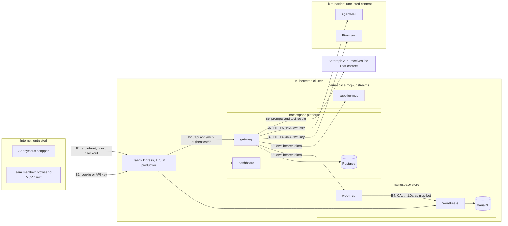

# Threat model

What we protect, from whom, where the trust boundaries are, and what is still possible. The four questions the
brief asks are sections 1 to 4. Controls point to the code that enforces them; "residual" means a risk we know
about and accept or have not fixed yet.

**Assumptions.** People who can run `kubectl` or `helm` against the cluster are trusted (they can read every
Secret anyway). Dashboard admins are trusted but fallible: their session can be stolen, so the design limits what
a stolen admin session can extract. Members are authenticated teammates who may be careless or malicious.
Shoppers are anonymous. Third-party MCP servers, the text they return, and anything shoppers type are untrusted.
The model provider (Anthropic) is a data processor that receives the chat context.

## Assets

| Asset | Where it lives | How it is protected |
|---|---|---|
| Upstream credentials (Firecrawl key, AgentMail key, internal MCP bearer tokens) | Kubernetes Secrets (seeds) and Postgres `upstream_servers.credential_enc` | AES-256-GCM with a key from Secret `gateway-internal` (AAD = server id), write-only API, never logged (`crypto/secretBox.ts`, `api/serverRoutes.ts`) |
| Members' API keys `mgw_<id>_<secret>` | Only `HMAC-SHA256(pepper, key)` in Postgres; the full key is shown once | Pepper in a Secret; checked on every request, never cached (`auth/mcpAuth.ts`) |
| Dashboard passwords and sessions | Postgres | scrypt (N=2^14, r=8, p=5); sessions stored as an HMAC of a 32-byte random token; HttpOnly cookie |
| The gateway's own keys (pepper, credentials key, chat JWT key, session secret) | Secret `gateway-internal`, env vars of the gateway pod | Generated once by `scripts/secrets.sh`, never printed |
| WooCommerce API key of `mcp-bot` | Secret `woo-store-api`; WooCommerce stores its hash | Only woo-mcp has it; role `urumi_mcp_bot` has 12 capabilities (products and orders only) |
| Store data, including customer names, emails, phone numbers, cities and order contents | MariaDB | Reachable only through WordPress; woo-mcp exposes billing name, email, phone and city but never street addresses |
| Shared credits and reputation (Firecrawl credits, the AgentMail inbox, Anthropic spend) | Third parties | Allowlists, policies, rate limits, approval step, audit |
| The audit log | Postgres | Written by the gateway only; members read only their own rows |
| The cluster and the cloud account | Kubernetes, EC2 | NetworkPolicies, SSRF guard, no service-account tokens, no RBAC needed |

## Trust boundaries

| Boundary | What crosses it | Enforced by |
|---|---|---|
| **B1** Internet → Ingress | Shoppers' requests, dashboard traffic, MCP requests | Only the `store.` and `app.` hosts are routed, and on `app.` only `/api` and `/mcp` reach the gateway (its `/healthz`, `/readyz` and metrics port are never routed). In production, TLS and an HTTP-to-HTTPS redirect for everything (`cluster/traefik-prod.yaml`). |
| **B2** Ingress → gateway authentication | Session cookies, API keys | `/api` needs a session (except login, logout and the invite-link pages), `X-Urumi-CSRF: 1` on every state-changing request, and the right role per route; `/mcp` accepts API keys only, never cookies; the chat's internal listener binds `127.0.0.1` and accepts only 5-minute chat JWTs. |
| **B3** Gateway → upstream MCP servers | Tool calls out; tool definitions and results back | Each server gets only its own credential. URLs pass the SSRF guard; the gateway's egress NetworkPolicy allows the two in-cluster MCP Services and public IPs on port 443 only. Everything coming back is untrusted content (section 3). |
| **B4** woo-mcp → WordPress | Signed REST calls | Bearer token on woo-mcp plus a NetworkPolicy that admits only gateway pods; OAuth 1.0a as `mcp-bot` with a minimal role. |
| **B5** Gateway → model provider | System prompt, conversation, tool definitions, tool results (which can contain customer data) | HTTPS; tool results capped at 20,000 characters per call. No redaction of personal data (residual). |
| **B6** Shopper-typed text → the model's context | Order notes, billing names, product text | Not a network boundary but the most important content boundary: see section 4. |

## 1. Shared upstream credentials: what a member can do with a credential they never see

A member can make the gateway **use** a credential, never **read** it:

- **Use:** call the tools that the server exposes, the allowlist permits and their role allows, at the allowed
  rate, with every call audited under their name. With the seeds that means: search, scrape and map public web
  pages through Firecrawl (spending the team's Firecrawl credits); read products and orders in the store,
  including customers' names, emails, phones and cities; read the supplier catalog. Members are denied
  `woo/create_product`, `woo/update_order_status` and `mail/send_message` by default.
- **Not read:** the API never returns a credential, only `hasCredential` (`api/dto.ts`); the dashboard field is
  write-only; credentials are encrypted at rest and never written to logs; the gateway's own error texts never
  contain them; outside the Kubernetes Secrets of the seeded servers, only the gateway process holds them, in
  memory.
- **Not redirect:** only admins edit servers, and even an admin cannot point a stored credential at another
  host. Changing a server's URL origin, auth type or header name without re-entering the credential is refused
  with `422 credential_required` (`api/serverRoutes.ts`), so a stolen admin session cannot point the Firecrawl
  server at its own host and read the key from the incoming request. Seeds are re-synced from their Secret only
  while the row still points where the seed file says (`seed/startup.ts`).

| Control | What it limits | Where |
|---|---|---|
| Write-only credential API, AES-256-GCM at rest | disclosure through the API, the browser, a database dump | `api/serverRoutes.ts`, `crypto/secretBox.ts` |
| Per-server tool allowlist | which capabilities of a credential are reachable at all (Firecrawl: 3 tools; AgentMail: `send_message` only) | `toolAllowlist` in `charts/platform/values.yaml` |
| Member deny policies (hidden **and** refused) | who may use write and outbound tools | `policies/policy.ts`, Tool policies page |
| Per-user rate limits: 60 tool calls per minute, 10 per minute per third-party server | how fast shared credits can be spent; per user because members can create any number of keys | `policies/rateLimit.ts` |
| Chat approval before destructive or outbound tools | the chat agent spending or sending without a human click | `chat/confirm.ts`, `chat/approvals.ts` |
| Audit log: every call, including denied and rate-limited ones | attribution after the fact | `audit/auditLog.ts`, Audit log page |
| Credential bound to its destination (`credential_required`) | a stolen admin session moving the key elsewhere | `api/serverRoutes.ts` |
| SSRF guard and egress NetworkPolicy | the gateway sending any credential into the cluster or to the cloud metadata endpoint | `security/ssrf.ts`, `charts/platform/templates/networkpolicies.yaml` |
| The narrowest credential the provider offers | blast radius if a credential leaks (the AgentMail key is scoped to one inbox) | at the provider |
| Disable the server, disable the member | an instant stop: tools hidden and refused, keys revoked, streams closed | `api/serverRoutes.ts`, `api/userRoutes.ts` |

**Residual.** The upstream sees every call as "the team": attribution exists only in our audit log. The rate
limits are per minute, with no daily budget, so a member can keep spending at 10 Firecrawl calls a minute. The
audit log keeps a hash of the arguments, not the arguments, so it shows *that* a member scraped something, not
*what*. And the gateway does not scan upstream responses for credentials: an upstream that echoed its own key
in an error would show it to the member (that upstream holds the key already, so this exposes it to members,
not to a new party).

## 2. Why client tokens are never passed through to upstreams

What reaches the gateway is a member's `mgw_` key (or, from the chat, a 5-minute JWT). What an upstream receives
is the gateway's **own** credential for that server, the MCP protocol headers and the tool arguments; never the
member's key, cookie or identity. This is structural, not a filter: `mcpRoutes` authenticates the
`Authorization` header and passes only a principal (user id, role, key prefix) to the MCP handler
(`mcp/mcpEndpoint.ts`); `ToolRouter.callTool` has no access to request headers; each upstream client is built
once from the server row's URL, auth type and decrypted credential (`upstreams/upstreamClient.ts`). Redirects are
refused, so not even the gateway's credential can be bounced to another host.

Why it must be this way:

1. **Token audience.** A gateway key is issued for one resource: this gateway. An upstream cannot validate a
   token it did not issue; it could only reject it or accept it blindly, and accepting tokens issued for someone
   else is exactly what OAuth audience binding (RFC 8707) exists to prevent. The chat JWT is bound the same way:
   `aud: urumi-gateway-internal`, HS256 only (the token cannot choose its algorithm), at most 5 minutes, accepted
   only on the loopback listener (`auth/chatToken.ts`).
2. **Confused deputy.** A gateway that forwarded client tokens would let whoever holds a token borrow the
   gateway's position (inside the cluster, past the NetworkPolicies) while the upstream's own checks
   (validation, rate limits, logging) ran against a credential that was never meant for it. Each side would
   believe the other had authorized the call.
3. **One bad upstream would collect every key.** With passthrough, every registered server, including
   third-party and admin-added ones, would receive every member's gateway key, and those keys work on our
   `/mcp`. A single malicious or compromised upstream could then act as any member against every other server.
   Without passthrough an upstream only ever holds its own credential.
4. **The MCP specification forbids it.** The authorization specification (section "Access Token Privilege
   Restriction") requires a server to accept only tokens issued for it and forbids passing the client's token
   through to an upstream API, which must get its own, separately issued token; the Security Best Practices page
   lists "token passthrough" as an anti-pattern.

The tradeoff: upstreams cannot make per-user decisions, so every per-user rule (policies, rate limits, audit)
lives in the gateway. If an upstream ever needed to know the user, the right design is a separate credential
minted per user for that upstream (OAuth token exchange or per-user upstream credentials), not forwarding ours.
That is not implemented.

## 3. Untrusted upstreams: tool descriptions written to manipulate the model

An admin can add any Streamable HTTP server, and a server that was fine yesterday can be compromised today. Such
a server controls its tool names, descriptions, input schemas, annotations, results, timing and response sizes,
and it sees the arguments the model sends it. Models read tool descriptions as instructions, so this is the
"tool poisoning" problem.

| Attack | Defence | Code |
|---|---|---|
| Hidden instructions in invisible characters (zero-width, bidi overrides, Unicode tag characters, variation selectors) | Removed from the description, the title and every `description`/`title` inside the input schema. A schema that still holds them in a property name, `enum` or `default` (which cannot be changed without breaking the upstream) is not exposed. | `catalog/naming.ts`, `catalog/catalog.ts` |
| Flooding the model's context | Description capped at 1,500 characters, titles at 200; a schema over 32 KB is not exposed; upstream responses over 4 MB are refused; results capped at 100,000 characters (20,000 for the chat model) | same; `security/ssrf.ts`, `mcp/toolRouter.ts`, `chat/loop.ts` |
| Shadowing a trusted tool (a server that calls its tool `create_product` or `woo__create_product`) | Every tool is prefixed with the admin-chosen slug, which cannot contain `__`; routing uses a lookup table; each description starts with `[<slug>]` | `catalog/naming.ts` |
| Lying annotations ("I am read-only") | Only the four MCP hints pass; a third-party server's hints are replaced with the worst case (may write, reaches the outside world) | `catalog/naming.ts` `exposedAnnotations` |
| Visible injection phrases ("ignore previous instructions", `<IMPORTANT>`, "do not tell the user", "system prompt", "before you answer anything") | Flagged `suspicious` on the dashboard and in a log warning. A warning, not a block: plain-English instructions cannot be detected reliably, and blocking on a phrase list would be false comfort. | `catalog/naming.ts` `looksLikeInjection` |
| Rug pull: a tool changes after it was reviewed | SHA-256 of each tool's definition; a change is logged, timestamped (`definitionChangedAt`), shown as "Definition changed" on the dashboard and pushed to clients as `list_changed` | `upstreams/manager.ts` `applyTools` |
| Exfiltration: the model is talked into sending store data to the attacker's tool | In the chat, every third-party tool needs the user's approval, which shows the arguments; members only get tools their policies allow | `chat/confirm.ts` |
| Using the gateway as an SSRF pivot | https only, public addresses only (checked again at connect time), no redirects | `security/ssrf.ts` |
| Hanging or slow responses | Connect, health and call timeouts; unreachable servers fail fast | `upstreams/manager.ts` |
| Smuggling data through `outputSchema` or `_meta` | Neither is passed to clients | `catalog/catalog.ts`, `mcp/toolRouter.ts` |

The supplier server has a demo switch for this: `DEMO_POISONED_DESCRIPTION=true` appends a labelled
`<IMPORTANT>` instruction to `check_stock`'s description. The dashboard then shows the tool as "Suspicious text"
and "Definition changed", and the gateway logs both.

**What still gets through.**

- An instruction written in ordinary language that the phrase lint does not match reaches the model, which may
  follow it. The real limits are human: admins review a server before adding it, the chat asks before anything
  destructive or outbound, and member policies limit what any manipulated agent can do. External clients
  (Claude Code, Cursor) apply their own confirmation rules; the worst-case hints help the ones that honour them.
- The gateway does not inspect or rewrite tool **results**. The system prompt tells the chat model that results
  are data, and results are size-capped, but that is all.
- A rug pull is detected, not prevented: the changed tool stays exposed until an admin disables the server or
  removes the tool from its allowlist.
- A server without an allowlist can list any number of tools, which costs context on every turn.
- Our own in-cluster servers keep their annotations because we wrote them. A host becomes "in-cluster" only
  through the Helm value `INTERNAL_HOST_ALLOWLIST`, never from the dashboard.

## 4. What one team member can do to another

| Attempt | Possible? | Controls and residual |
|---|---|---|
| Read another member's API key | No | Only an HMAC is stored; the full key is shown once to its creator. A member who asks for someone else's keys gets 403, and one who tries to revoke someone else's key gets 404. |
| Act as another member | Only with their key or session | Calls are audited under the key's owner. Keys are revocable instantly. |
| See another member's activity | No | Members see only their own audit rows; a member's `userId` filter is ignored, never widened. Admins see all rows. |
| Change servers, policies or roles | No | Admin-only routes. The last active admin cannot be demoted or disabled. |
| **Inject instructions into another user's agent through store data** | Yes, partly mitigated | Anyone who can write store data can plant text that another user's agent later reads: a guest's order note or billing name (any anonymous shopper), a product name or description (whoever may create products: admins by default). woo-mcp removes invisible characters from and caps the order note (500 characters), the billing name (100) and product descriptions (HTML stripped, 1,000), and its schemas say these fields are data, never instructions. The chat's system prompt says the same. The approval step stops destructive and outbound tools (`update_order_status`, email, every Firecrawl tool) until a human clicks; `refunded` cannot be set at all. **Residual:** product names and the billing city are passed as WooCommerce stores them, and an injected instruction can still make the agent run tools that need no approval: reads, and for admins `create_product`, which shows in the audit log and on the storefront. |
| Undo another member's work through shared write tools | Admins only, by default | WooCommerce sees every change as `mcp-bot`; there is no per-object ownership. Members are denied the store's write tools by default; the audit log shows which user changed something and when (not which order: arguments are hashed). |
| Drain shared credits | Bounded, not prevented | Per-user tool-call limits; the chat runs one reply per user, at most 8 model calls each. There is no daily budget per user. The audit log attributes tool calls, and the gateway log line `chat turn` records each user's token usage. |
| Slow others down | Bounded | Rate limits are per user, so one member at the limit does not block others, but everyone shares one gateway pod, the upstreams' own rate limits and WordPress's 10 PHP workers. |
| Lock another member out of the dashboard | Yes, for 15 minutes | The login throttle counts per email address, so five wrong passwords for someone's email block their login for 15 minutes. Their API keys keep working. An ingress rate limit per source address would be the fix. |
| Abuse an invite link | Only if it leaks | Links are single-use, valid 72 hours, stored as an HMAC and redacted from nginx access logs; the dashboard sends `Referrer-Policy: no-referrer`. A leaked unused link is still a bearer secret: the first person to open it gets the account. |

**What admins can do to members.** Admins are trusted, but their powers are worth stating: they can disable a
member (which revokes the member's keys, ends their sessions and closes their open streams), change roles and
policies, read every audit row, and issue an API key *for* a member. The admin sees that key once, so an admin
can act as the member through it; the audit row shows the member and the key prefix, while the database records
who issued the key (`api_keys.created_by`). When an admin is disabled or demoted, every key they issued for
someone else and every invite they left open is revoked (`api/userRoutes.ts`), so a removed admin cannot come
back through a saved key or invite link.

## Other threats

### Server-side request forgery

Admins type upstream URLs, and the gateway sits inside the cluster, so a URL is a way to make the gateway fetch
something the admin could not reach: the cloud metadata service at `169.254.169.254`, a database Service, the
Kubernetes API. `apps/gateway/src/security/ssrf.ts`:

- Only hosts listed in `INTERNAL_HOST_ALLOWLIST` (a Helm value, today woo-mcp and supplier-mcp) may be inside the
  cluster, and only they may use plain `http`.
- Every other URL must be `https`, and **every** address its name resolves to must be ordinary public unicast
  (ipaddr.js `range() === 'unicast'`: loopback, private, link-local, CGNAT, unique-local, multicast, NAT64, 6to4
  and IPv4-mapped forms are refused). Decimal, octal and hex spellings of an IPv4 address are normalised by the
  URL parser first, so they are caught too. Credentials inside the URL are refused.
- The check runs when the URL is saved (a clear 422) and again **at connect time** on the address actually
  dialled, which defeats DNS rebinding. Redirects are errors.
- Underneath, the gateway's egress NetworkPolicy allows only the two MCP Services in the cluster and public IPs
  on port 443, with private, CGNAT, link-local and loopback ranges carved out.

### Secrets handling

- External secrets come from the gitignored `.env`; `scripts/secrets.sh` creates every Secret, never prints a
  value, strips Windows `\r`, and uses server-side apply so no copy lands in the `last-applied-configuration`
  annotation. Internal secrets are random and generated once.
- Charts reference Secrets by name only; containers read them through `secretKeyRef` env vars.
- Logs never contain keys, credentials, tool arguments, prompt text or database bound parameters: database
  errors are logged as SQLSTATE, constraint and table only (`db/errors.ts`); configuration errors name the
  variable, never the value. nginx redacts invite tokens from its access log.
- At rest: upstream credentials encrypted; API keys, sessions and invite tokens stored as HMACs; passwords as
  scrypt hashes. Kubernetes Secrets themselves are only base64 in the local cluster's datastore; on the VPS,
  `scripts/vps/bootstrap-k3s.sh` turns on k3s secrets encryption (`secrets-encryption: true`; checked on a
  stand-in VPS: a Secret's value was not found in the datastore files, a ConfigMap's was), and the EBS volume is
  encrypted too (see [VPS.md](VPS.md#security-notes)).
- Database dumps (`backup.enabled`, on in production) hold customer data and password hashes. They are written
  with `umask 077` by the database's own uid onto a PVC that only backup pods mount; backup pods log in as the
  app user, never root, and may reach only the database port. `scripts/backup/fetch.sh` saves copies outside the
  repository with mode 0600, and `.gitignore` excludes `*.sql`, `*.sql.gz` and `*.dump`. A gateway dump holds
  only encrypted upstream credentials and key hashes: without the `gateway-internal` Secret (never in a dump) it
  cannot be used to call an upstream or to forge an API key.

### Network isolation

- Every pod of every release starts with **default-deny** ingress and egress; each allowed path is its own
  policy (tables in the [platform](../charts/platform/README.md#network-policies) and
  [woo-store](../charts/woo-store/README.md#network-policies) chart READMEs). Tested from real pods by
  `scripts/e2e-store.mjs` (f1 to f3).
- The store has no internet egress at all, and WordPress has `WP_HTTP_BLOCK_EXTERNAL` set.
- Defence in depth: kube-router applies policies to a brand-new pod only after a few seconds, so both in-cluster
  MCP servers also require a bearer token (compared in constant time), and Postgres requires a password for
  every network connection.
- Limits: kubelet probes come from the node and are always allowed; `kubectl port-forward` bypasses
  NetworkPolicies (fine for an operator, useless as a test); any pod in `platform` labelled
  `app.kubernetes.io/component: gateway` gets the gateway's network access, so that label is reserved (the
  `mcp-server` chart refuses it). The metrics port is closed unless `networkPolicy.metricsFrom` names a scraper.

### Authentication and the dashboard

Sessions are 32 random bytes in an HttpOnly, SameSite=Lax cookie (`Secure` in production), 12-hour sliding
expiry. Every state-changing `/api` request needs `X-Urumi-CSRF: 1`, which a cross-site page cannot send without
a CORS preflight the gateway never answers. Logins for unknown emails still run one scrypt hash, so timing does
not reveal which accounts exist. API key checks compare the secret before looking at revocation, so guessing key
ids reveals nothing, and unattributable rejections are audited at most 60 times a minute so a scanner cannot
flood the table. The dashboard serves a strict Content-Security-Policy (`default-src 'self'`) and renders chat
text as text, never as HTML.

### Kubernetes posture

Namespaces enforce the Pod Security `baseline` profile and warn and audit on `restricted`. Every container runs
as non-root with a read-only root filesystem, no privilege escalation, all capabilities dropped, seccomp
`RuntimeDefault`, and requests and limits. None of our components talks to the Kubernetes API, so no
service-account token is mounted in any of our pods (the backup Jobs included) and our charts need no RBAC rules.
The exception in production is cert-manager, a cluster add-on that manages Certificates through the API with its
own RBAC; its namespace enforces Pod Security `restricted`. Charts refuse to render an empty or `latest` image
tag.

### Supply chain

- Base images are pinned by tag (`node:24.21.0-alpine3.24`, `nginxinc/nginx-unprivileged:1.30.5-alpine3.24`,
  `wordpress:7.1.3-php8.3-apache`, `mariadb:11.8.9`, `postgres:18.6-trixie`), not by digest.
- WooCommerce and Storefront zips are checked against SHA-256 values computed from the official downloads
  (trust on first use; wordpress.org publishes none); WP-CLI against its published SHA-512.
- npm dependencies are locked (`pnpm-lock.yaml`, `--frozen-lockfile` in image builds); the MCP SDK is pinned to
  an exact version.
- `scripts/setup-wsl-docker.sh` verifies the kubectl and Helm checksums; k3d comes from its official install
  script (fetched from the project's main branch) with a pinned release tag.
- Hosted upstreams change without notice; that is what the rug-pull detection is for.
- CI (`.github/workflows/ci.yml`) pins every GitHub Action to a full commit SHA, runs with a read-only token
  (only the image job gets `packages: write`), downloads kubeconform against a SHA-256 written in the workflow,
  and builds production images from the same commit it tested, tagged with that commit, never `latest`.
- On the VPS, the k3s installer is checked against a pinned SHA-256 and cert-manager is a pinned chart version.
- Not done: image signing, SBOMs, dependency or image scanning in CI.

### Data sent to the model provider

The chat sends the system prompt, the conversation, the tool definitions and the tool results to Anthropic.
Tool results can include customer names, emails, phone numbers and order contents. Nothing is redacted; using
the chat on real customer data means accepting the provider as a processor of that data.

## Residual risks

| Risk | Current mitigation | What would close it |
|---|---|---|
| Plain-language prompt injection in tool descriptions or results | Approval step for destructive and outbound tools, policies, system prompt, size caps, `suspicious` flag | Admin review of every server; per-tool approval rules for external clients; result filtering |
| Injected instructions trigger non-gated tools (reads; `create_product` for admins) | Audit log; `create_product` only adds data | Approval for every write, at the cost of an extra click per product |
| Rug pulls detected but not blocked | Hash, log warning, dashboard flag, `list_changed` | Quarantine a changed tool until an admin re-approves it |
| Credit draining within the per-minute limits | Rate limits, one chat reply per user, audit, token counts in logs | Daily per-user budgets |
| Login lockout of a known email | Throttle is per email, 15 minutes | Rate limit per source address at the ingress |
| Customer data sent to the model provider | Members' policies; caps | Redaction of personal fields before results reach the model |
| No per-user identity at upstreams | Gateway audit | Per-user upstream credentials or token exchange |
| Secrets not encrypted at rest in the local cluster | Local only; production enables k3s secrets encryption | — |
| Images pinned by tag, not digest; no scanning or signing | Pinned versions, checksums for downloaded code | Digests, image scanning and signing in CI |
| In-memory limits and approvals (one replica) | Single replica by design | Shared state before scaling out ([DESIGN.md](DESIGN.md#scaling-limits)) |
